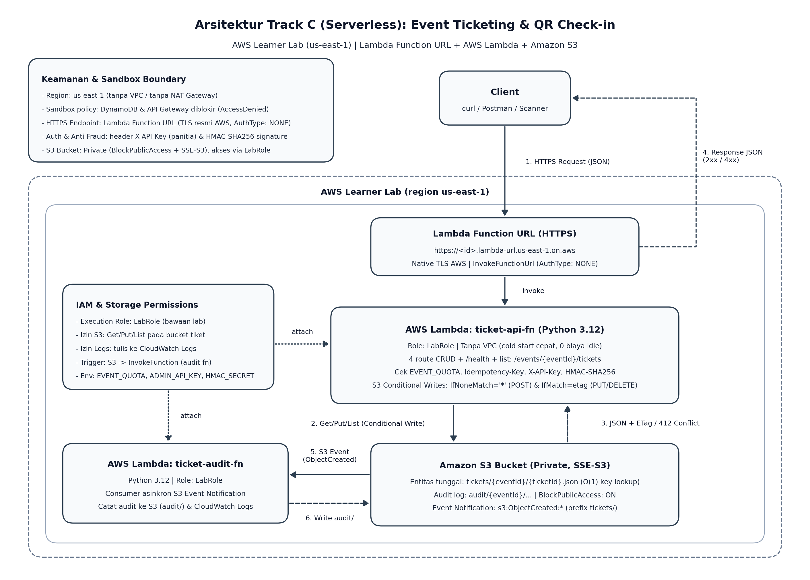

# Event Ticketing & QR Check-in (Track C: Serverless)

Sistem manajemen reservasi dan *check-in* tiket acara kampus yang dibangun di AWS menggunakan arsitektur **Track C (Serverless)**: **Lambda Function URL (HTTPS) + AWS Lambda (Python 3.12) + Amazon S3**.

## Arsitektur



- **Entitas tunggal:** `Ticket` disimpan sebagai objek JSON di Amazon S3 pada key `tickets/{eventId}/{ticketId}.json` (akses langsung **O(1)**).
- **Keamanan & IAM:**
  - Kedua fungsi Lambda (`ticket-api-fn` dan `ticket-audit-fn`) berjalan dengan **`LabRole`** dan tanpa VPC.
  - Bucket S3 bersifat *private* (*Block Public Access* + enkripsi SSE-S3); hanya Lambda yang memiliki izin baca/tulis.
  - Endpoint HTTPS dilayani langsung oleh **Lambda Function URL**; aksi panitia (`paid`, `checked-in`) dilindungi header `X-API-Key` dan token tiket dilindungi **HMAC-SHA256 signature**.
  - **Alasan pemilihan stack:** Pada *sandbox* AWS Learner Lab, `dynamodb:CreateTable` dan `apigateway:POST` diblokir (`AccessDeniedException`), sehingga **Lambda Function URL + S3 Conditional Writes** digunakan sebagai arsitektur Serverless murni.

## Fitur & Aturan Bisnis Utama

- **Kuota & Idempotensi:** Pengecekan `EVENT_QUOTA` sebelum pembuatan tiket, serta S3 conditional write `IfNoneMatch='*'` dengan header `Idempotency-Key` untuk mencegah tiket ganda.
- **Anti-Double Check-in:** Pembaruan status memakai S3 conditional write `IfMatch=etag` (*optimistic locking*), sehingga dua *scan* bersamaan tidak dapat melakukan *check-in* dua kali (`409 CONCURRENT_MODIFICATION`).
- **Siklus Status & Auto-Expire:** `reserved → paid → checked-in`, pembatalan *soft delete* (`cancelled`), dan otomatis berubah ke `expired` (`409 TICKET_EXPIRED`) saat `PUT` (`paid`) melewati `expiresAt`.
- **Event-Driven Audit:** *S3 Event Notification* (`s3:ObjectCreated:*` pada `tickets/*.json`) memicu `ticket-audit-fn` secara asinkron untuk mencatat log audit ke `audit/` dan CloudWatch Logs.

## Endpoint API

| Method & Path | Fungsi | Keterangan |
|---|---|---|
| `GET /health` | Cek API & akses bucket S3 | Mengembalikan `ok` jika `HeadBucket` berhasil |
| `POST /events/{eventId}/tickets` | Pesan tiket baru (`reserved`) | Mendukung `Idempotency-Key` & cek `EVENT_QUOTA` |
| `GET /events/{eventId}/tickets` | Daftar tiket satu acara | Mendukung query parameter `limit` (`1`–`100`) |
| `GET /events/{eventId}/tickets/{ticketId}` | Detail satu tiket | `404` jika tidak ditemukan |
| `PUT /events/{eventId}/tickets/{ticketId}` | Ubah `holderName` atau status (`paid`, `checked-in`) | Transisi status wajib `X-API-Key`; `checked-in` wajib `signature` |
| `DELETE /events/{eventId}/tickets/{ticketId}` | Batalkan tiket (`cancelled`) | *Soft delete*, `409` jika sudah berstatus akhir |

## Environment Variables

Konfigurasi runtime Lambda disuntikkan saat deployment (tidak disimpan di Git):

```env
BUCKET_NAME=ticketing-serverless-<account-id>
EVENT_OPEN=true
EVENT_QUOTA=50
PAY_WINDOW_MINUTES=30
ADMIN_API_KEY=<secret-admin-key>
HMAC_SECRET=<secret-hmac-key>
```

## Struktur Repositori

```
microservices/
├── README.md
├── .gitignore
├── docs/
│   ├── architecture.png             # Diagram arsitektur Track C
│   └── event-ticketing-design.md    # Rancangan teknis lengkap
├── src/
│   ├── __init__.py
│   ├── api_handler.py               # Lambda API router + S3 conditional writes
│   ├── audit_handler.py             # Lambda consumer S3 Event Notification
│   └── ticket_crypto.py             # Helper HMAC-SHA256 signature
├── scripts/
│   ├── aws_setup.sh                 # Provisioning S3, 2 Lambda, Function URL, & S3 trigger
│   └── cleanup.sh                   # Hapus resource AWS & artefak lokal
├── tests/
│   └── test_api.sh                  # Pengujian curl end-to-end
└── evidence/                        # Screenshot AWS Console & output pengujian
```

## Rencana Deployment & Verifikasi (AWS Sandbox)

Provisioning dapat diulang dalam hitungan detik dengan satu perintah:

```bash
# 1. Deploy S3 bucket, Lambda audit + trigger, dan Lambda API + Function URL
ADMIN_API_KEY='kunci-panitia' HMAC_SECRET='rahasia-hmac' ./scripts/aws_setup.sh

# 2. Jalankan uji konektivitas & skenario end-to-end
./tests/test_api.sh

# 3. Bersihkan resource setelah selesai
./scripts/cleanup.sh
```
